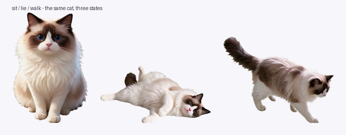

# Ambient Pet for DeepSeek Harness

A desktop-pet plugin for the **DeepSeek Harness Web GUI**: a soft ambient wallpaper behind the
interface plus a cat that lives in the bottom-right corner of the window.



## What it does

| State | Trigger | Behaviour |
|---|---|---|
| `sit` | idle | sits and bobs gently |
| `lie` | pointer over the cat | lies down, breathing |
| `walk` | dragging | side view, trots after the pointer and mirrors to the drag direction |

Clicking the cat makes it hop and say a line; the text follows the UI language (English / 中文).
The pet can be dragged anywhere in the window and stays inside the viewport.

The wallpaper is painted on the document body, and the frame's `--dsw-alias-bg-base` token is
pushed to a translucent value through the supported `ctx.theme.overrideTokens` layer, so the
wallpaper reads through the application chrome without touching another plugin's DOM.

## Install

The plugin is a normal Harness bundle (`package.json` + `cordis.patch.yml` + a Host half and a
Client half). Install the `plugin/` directory as a local bundle with the Harness plugin manager
(`install_bundle` pointing at that directory), then enable the bundle and reload the Web GUI.
Everything the plugin adds is registered through `ctx.effect`, so disabling it restores the
original page.

## Layout

```
plugin/
  package.json        bundle manifest (dsh.bundle.patch + dsh.client)
  cordis.patch.yml    inserts the Loader row
  index.js            Host half: nothing but a Loader row
  client.js           Client half: wallpaper CSS, theme token override, shell.overlay pet
  locale/en.json      Plugin Manager title/description
  locale/zh.json
  icon.svg
assets/               the three poses, extracted from the bundle for the README
```

The three poses are inlined into `client.js` as WebP data URIs (`PET_SIT`, `PET_LIE`, `PET_WALK`),
so the installed bundle has no external asset dependency. To use your own cat, replace those three
constants with your own images (any PNG/WebP, transparent background, ~320 px on the long edge).

## Notes

- Requires a Harness build whose Client half exposes `ctx.slots`, `ctx.theme` and `ctx.locale`.
- The wallpaper overrides one theme token; the pet itself is one `shell.overlay` entry, so it
  composes with the shipped overlay entries instead of replacing them.

## License

Code: MIT (see `LICENSE`).
The cat artwork belongs to the author of this repository; replace it with your own before
redistributing a fork.
